<div align="center">

<a href="https://goodboy-ai.dev">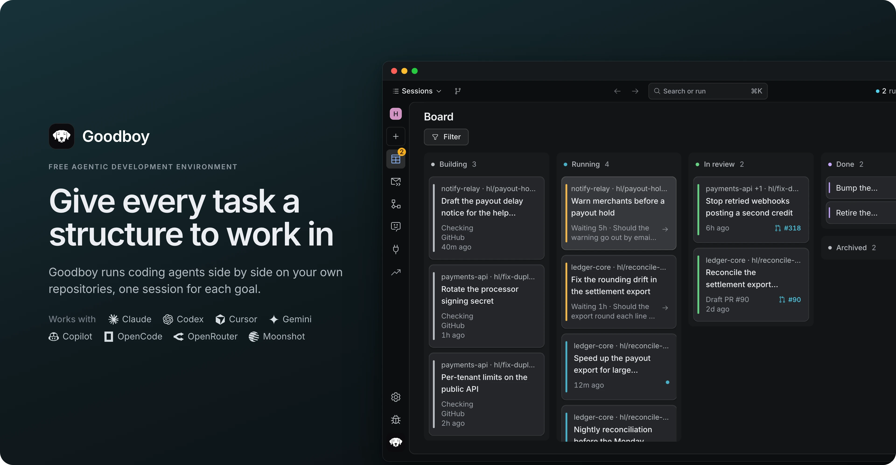</a>

<br>

Goodboy runs coding agents side by side on your own repositories, one session for each goal.

**Download for** [**macOS**](https://github.com/akhayam99/goodboy/releases/latest) &nbsp;&bull;&nbsp; [**Linux**](https://github.com/akhayam99/goodboy/releases/latest)

[Live demo](https://demo.goodboy-ai.dev) &nbsp;&bull;&nbsp; [Features](#features) &nbsp;&bull;&nbsp; [Documentation](#documentation) &nbsp;&bull;&nbsp; [Changelog](./CHANGELOG.md)

[](https://github.com/akhayam99/goodboy/stargazers)
[](https://github.com/akhayam99/goodboy/releases/latest)

</div>

<br>

## From task to pull request

<table>
<tr>
<td width="44%" valign="middle">

### Tasks

Issues, pull requests, Sentry errors and Slack threads from your tools sit in one list. Start a session from any of them, with the issue linked and its goal written in.

[Docs →](./docs/features/inbox.md#tasks)

</td>
<td width="56%">

<picture>
  <source media="(prefers-color-scheme: dark)" srcset="./docs/readme/readme-tasks-dark.webp">
  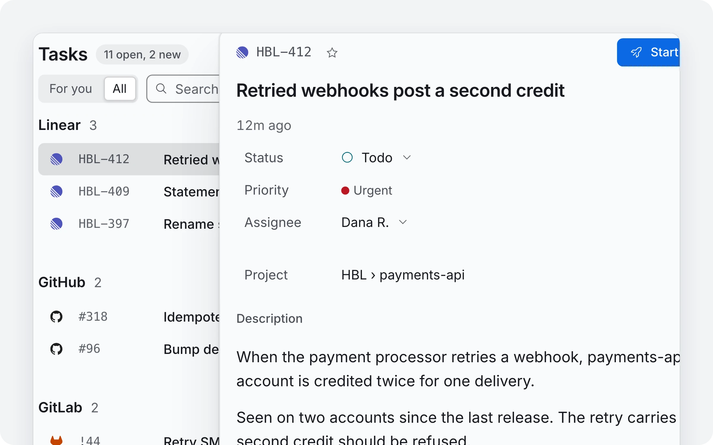
</picture>

</td>
</tr>
<tr>
<td width="44%" valign="middle">

### The Lead

A **Lead** plans the run, hands each part to a helper agent and asks you only what your permission rows say. Each helper runs on the provider and model that fit its job, and you can read why the Lead chose it.

[Docs →](./docs/features/agents.md#lead)

</td>
<td width="56%">

<picture>
  <source media="(prefers-color-scheme: dark)" srcset="./docs/readme/readme-lead-dark.webp">
  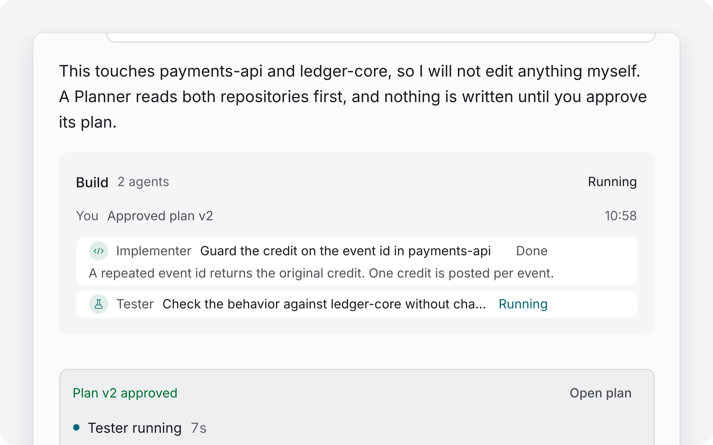
</picture>

</td>
</tr>
<tr>
<td width="44%" valign="middle">

### Questions

When an agent needs a decision, it asks once, with the options and the one it recommends. What waits on you sits on top of the board, and **Let an agent decide** hands the choice back.

[Docs →](./docs/features/board.md#needs-you)

</td>
<td width="56%">

<picture>
  <source media="(prefers-color-scheme: dark)" srcset="./docs/readme/readme-questions-dark.webp">
  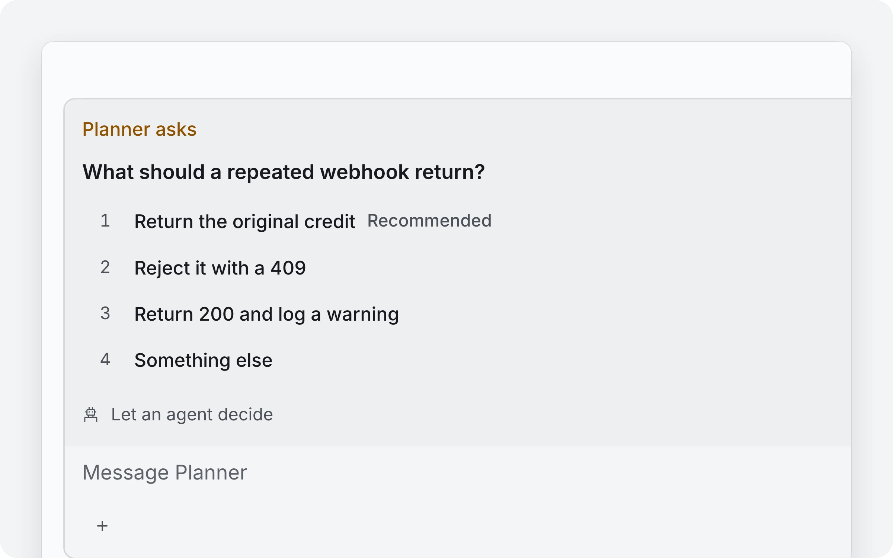
</picture>

</td>
</tr>
<tr>
<td width="44%" valign="middle">

### Plans

When the Lead asks you after the plan or at every step, a planner reads the code and writes the plan first. Comment on a line, and the next version says what it did with it.

[Docs →](./docs/features/artifacts.md#comment-on-a-plan)

</td>
<td width="56%">

<picture>
  <source media="(prefers-color-scheme: dark)" srcset="./docs/readme/readme-plan-dark.webp">
  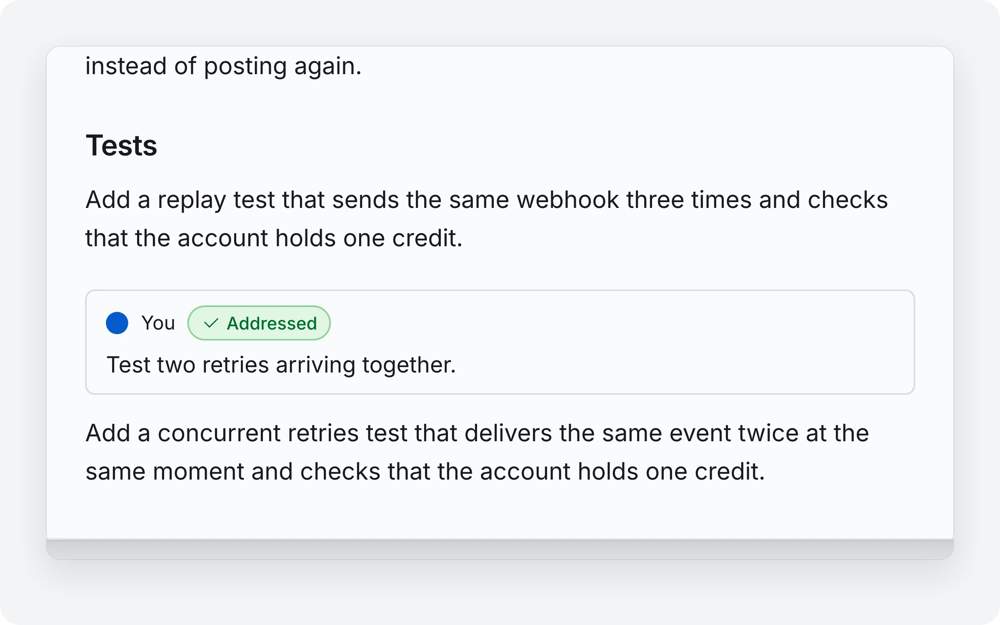
</picture>

</td>
</tr>
<tr>
<td width="44%" valign="middle">

### Providers and limits

Goodboy runs the agents you already pay for: Claude, Codex, Cursor and five more. When one hits its usage limit, the work moves to the next and keeps what it knew.

[Docs →](./docs/features/providers.md#fallback-when-a-limit-is-hit)

</td>
<td width="56%">

<picture>
  <source media="(prefers-color-scheme: dark)" srcset="./docs/readme/readme-limits-dark.webp">
  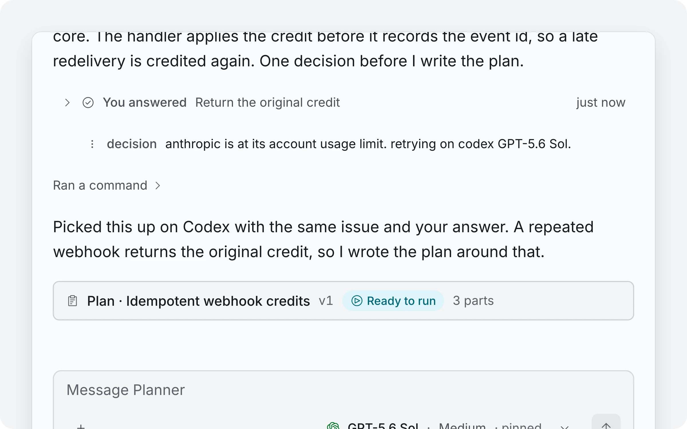
</picture>

</td>
</tr>
<tr>
<td width="44%" valign="middle">

### Projects

One session can work across several repositories, each on its own branch and pull request. The overview shows where every branch stands, and **Merge in order** lands them one after the other.

[Docs →](./docs/features/workspace.md#workspace-with-several-folders)

</td>
<td width="56%">

<picture>
  <source media="(prefers-color-scheme: dark)" srcset="./docs/readme/readme-projects-dark.webp">
  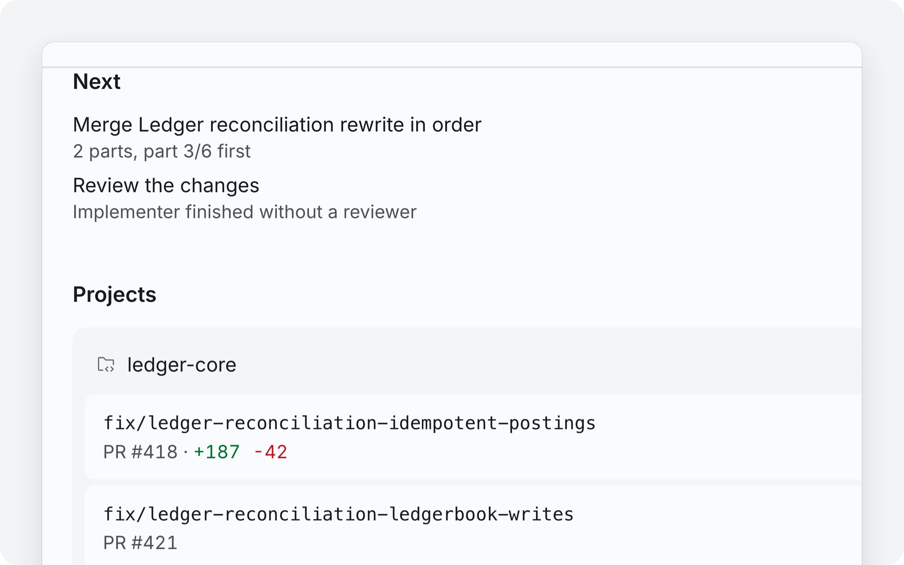
</picture>

</td>
</tr>
<tr>
<td width="44%" valign="middle">

### Pull requests

Every pull request has a page with its state, checks, reviewers and comments, so you see at a glance why it isn't ready to merge. **Fix checks** sends an agent after a red check, and **Fix** turns the review comments you pick into commits in its own copy of the branch.

Nothing leaves your machine until you push, on GitHub, GitLab or Bitbucket.

[Docs →](./docs/features/review.md)

</td>
<td width="56%">

<picture>
  <source media="(prefers-color-scheme: dark)" srcset="./docs/readme/readme-prs-dark.webp">
  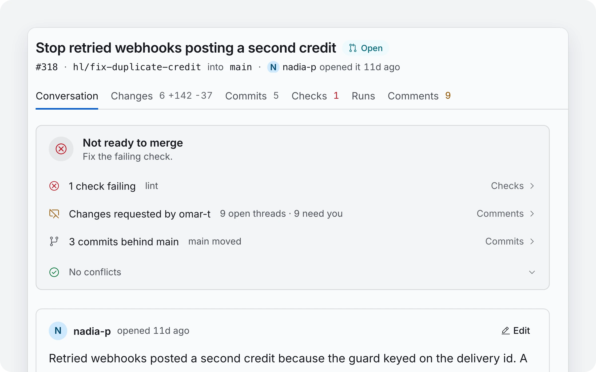
</picture>

</td>
</tr>
</table>

<br>

## Built-in tools

<table>
<tr>
<td width="44%" valign="middle">

### Browser

Open your dev server, a port or a link beside the session. Press **⌘⇧C** and click the part of the page you want changed. The agent gets its HTML, styles and a picture, and on your dev server the file and line.

[Docs →](./docs/features/keyboard.md#point-at-part-of-a-page)

</td>
<td width="56%">

<picture>
  <source media="(prefers-color-scheme: dark)" srcset="./docs/readme/readme-browser-dark.webp">
  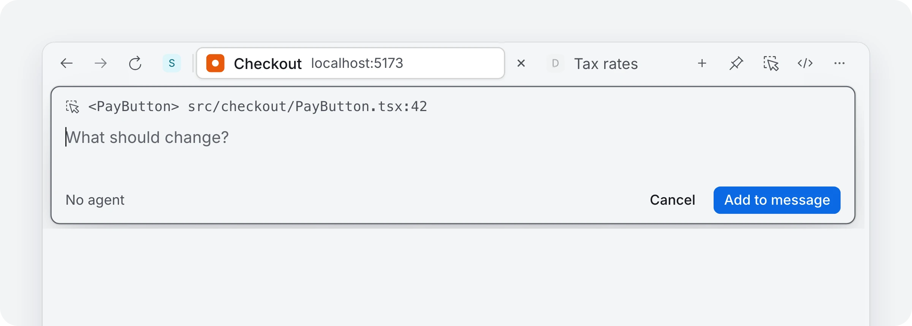
</picture>

</td>
</tr>
<tr>
<td width="44%" valign="middle">

### Monitoring

**Monitor** shows which ports are taken and by whom. It lists the agents Goodboy runs, your workspace servers and everything else listening on this Mac, with CPU and memory.

[Docs →](./docs/features/workspace.md#monitoring)

</td>
<td width="56%">

<picture>
  <source media="(prefers-color-scheme: dark)" srcset="./docs/readme/readme-ports-dark.webp">
  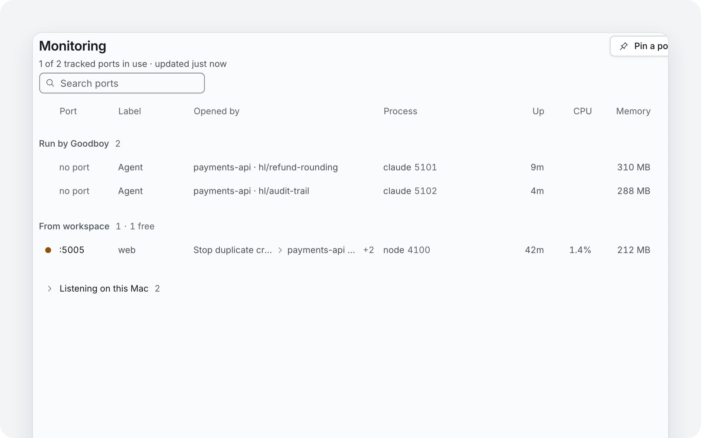
</picture>

</td>
</tr>
<tr>
<td width="44%" valign="middle">

### Storage

The worktrees of finished sessions add up. Goodboy lists each folder with its size and removes the safe ones only when you say so, and **Undo** puts them back.

[Docs →](./docs/features/storage.md#worktree-folders)

</td>
<td width="56%">

<picture>
  <source media="(prefers-color-scheme: dark)" srcset="./docs/readme/readme-storage-dark.webp">
  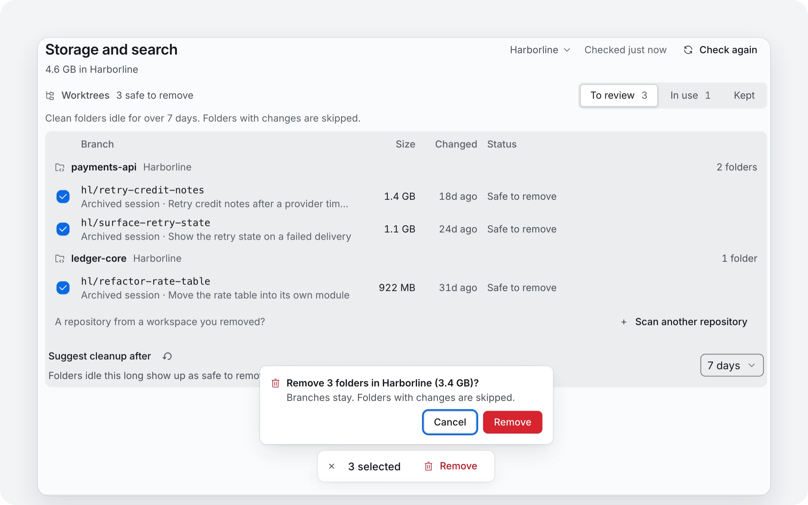
</picture>

</td>
</tr>
</table>

<br>

## Features

- **[Board](./docs/features/board.md)**: every session in five lanes, from **Open** to **Done**, with what waits on you on top
- **[Shared context](./docs/features/context.md)**: the goal, decisions and a running summary travel with the session, so a new agent starts informed
- **[Chat](./docs/features/agents.md#workspace-chat)**: ask about your repos without starting a session, then start work from the answer
- **[Workflows](./docs/features/workflows.md)**: save the steps of a run, each with its role, model and effort
- **[Cost and limits](./docs/features/providers.md)**: set a monthly cap per provider, and see what Goodboy got done and what it cost in **Impact**
- **[Terminal and keyboard](./docs/features/keyboard.md)**: a real login shell in any worktree, and a shortcut for every move

The [feature guide](./FEATURES.md) covers every area, and [goodboy-ai.dev](https://goodboy-ai.dev) tells the same story in a minute.

<br>

<a id="where-your-work-lives"></a>

## Privacy

- Tasks, decisions, settings and usage records stay on your computer, in `~/.goodboy`
- Prompts go to the provider you chose
- Tool keys go in your system credential store
- No account, and no Goodboy server

[What leaves your machine](./SECURITY.md#your-data) lists every request Goodboy makes.

<br>

## Install

On **macOS**, with Homebrew:

```bash
brew install --cask akhayam99/tap/goodboy
```

Or pick a package from the [latest release](https://github.com/akhayam99/goodboy/releases/latest):

- **macOS**: the `.dmg`, then drop Goodboy in Applications
- **Linux**: `AppImage`, `.deb` or `.rpm`

Goodboy runs the agents you already pay for: Claude, Codex, Cursor and five more. You sign in to each from the app, or paste its key, and keys stay in your system credential store.

<br>

## Run from source

Goodboy is built with **Tauri 2**, **React 19**, **TypeScript** and **SQLite**. You need **Node 22** or newer, **pnpm 10.33.4** and a **Rust** toolchain.

```bash
pnpm install
pnpm tauri:dev
```

- `pnpm tauri:build` produces a production build
- The [Tauri prerequisites](https://v2.tauri.app/start/prerequisites/) list the platform packages
- The [desktop notes](./apps/desktop/README.md) cover the local loop

<br>

## Documentation

Start with the page for what you want to do:

- [Your first task](./docs/first-session.md): from install to a merged pull request
- [Concepts](./docs/concepts.md): sessions, workspaces, projects and how they fit
- [Providers](./docs/providers.md): installation and sign-in for each one
- [Workflows](./docs/workflows.md): steps, the orchestrator and hands-free runs
- [Keyboard shortcuts](./docs/features/keyboard.md): every chord, by area
- [Where your data lives](./SECURITY.md#your-data): what stays on your computer and what leaves it
- [Query bridge](./docs/query-bridge.md): how agents read from your tools
- [Walkthroughs](./docs/walkthroughs/fix-a-failing-check.md): fix a failing check, comment on a plan, review with comments in place

Working on Goodboy? Start at the [contributor map](./docs/README.md), then read [Architecture](./docs/architecture.md).

<br>

## Contributors

[](https://github.com/akhayam99)
&nbsp;
[](https://github.com/teckperry)
&nbsp;
[](https://github.com/LucaPav01)
&nbsp;
[](https://github.com/Samux01)
&nbsp;
[](https://github.com/stefanozanini)

<br>

## Support Goodboy

The best support is using it.

- Run it on your real work
- Press **⌘I** in the app when something feels off, or you have an idea
- Open an [issue](https://github.com/akhayam99/goodboy/issues)
- Send a pull request
- Leave a star if it earns one

[](https://github.com/akhayam99/goodboy/stargazers)
